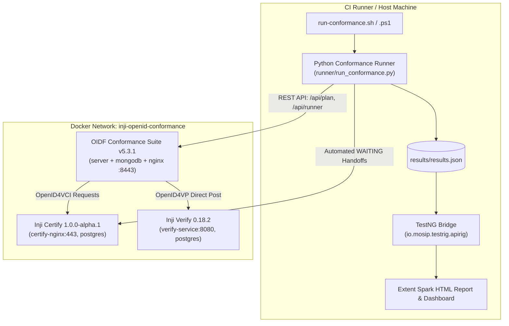

# AutoConform: Automated Conformance Testing for Inji Certify & Inji Verify

[](https://github.com/upadhyayaditya7/Testing_for_inji_certify_and_inji-verify/actions/workflows/full-stack-conformance.yml)
[](https://upadhyayaditya7.github.io/Testing_for_inji_certify_and_inji-verify/results/conformance-report.html)
[](runner/configs/benchmark.json)
[](https://gitlab.openid.net/openid/conformance-suite)
[](testrig-bridge/)
[](LICENSE)

> **MOSIP Decode 2026 Hackathon Submission**  
> **Team FSD**: Kirt Raj Dixit · Aditya Upadhyay — Pranveer Singh Institute of Technology (PSIT), Kanpur  
> **Track**: Digital Credential Trust Infrastructure / Automated Conformance Testing  
> 🌐 **Live Interactive Audit Dashboard**: [https://upadhyayaditya7.github.io/Testing_for_inji_certify_and_inji-verify/](https://upadhyayaditya7.github.io/Testing_for_inji_certify_and_inji-verify/)

---

AutoConform is a standalone, CI-ready conformance harness that spins up **Inji Certify** (credential issuer), **Inji Verify** (verifier), and a local **OpenID Foundation (OIDF) Conformance Suite**, drives the suite REST API, automates the interactive mobile-wallet `WAITING` handoffs, and feeds each plan into the existing MOSIP TestNG / Extent **api-testrig** reporting pipeline.

> **Key Architectural Guarantee:** This harness implements **zero OpenID protocol tests itself**. Protocol assertions and cryptographic verifications remain 100% inside the official OpenID Foundation Conformance Suite. AutoConform orchestrates, automates handoffs, and governs results.

---

## 📊 Conformance Results & Interactive Evidence

Execution results from the full combined run against Inji Certify 1.0.0-alpha.1 and Inji Verify 0.18.2:

- **[Interactive Visual Dashboard](results/conformance-report.html)**: Standalone HTML report featuring real-time filters, pass/fail badges, duration metrics, and spec gap root-causes.
- **[Full Raw Results JSON](results/results.json)**: Machine-readable JSON output matching `ResultMapper.java` and TestNG data providers.
- **[Component Results]**: [Certify Issuer Results](results/certify/results.json) · [Verify Verifier Results](results/verify/results.json)
- **[Regression Diff](results/diff.json)**: Zero regressions verified against baseline.

### Summary Metrics

| Target Component | Plan | Ran / Total Modules | Passed | Expected Skips / Gaps | Unexpected Failures | Compliance Gate |
|---|---|---|---|---|---|---|
| **Inji Certify** | `oid4vci-1_0-issuer-test-plan` | 13 / 20 | 13 | 7 (unattended skips) | 0 | **PASSED** (100% required) |
| **Inji Verify** | `oid4vp-1final-verifier-haip-test-plan` | 16 / 16 | 5 | 11 (HAIP 1.0 vs Draft 21) | 0 | **PASSED** (Documented gaps) |
| **Combined** | *Both plans orchestrated* | 29 / 36 | 18 | 18 | 0 | **BENCHMARK MET** |

---

## ⚡ Quick Start: One Command

```bash
# Clone the repository
git clone https://github.com/upadhyayaditya7/Testing_for_inji_certify_and_inji-verify.git
cd Testing_for_inji_certify_and_inji-verify

# Linux / macOS / WSL
./scripts/run-conformance.sh --component certify
./scripts/run-conformance.sh --component verify
./scripts/run-conformance.sh --combined

# Windows PowerShell
.\scripts\run-conformance.ps1 -Component certify
.\scripts\run-conformance.ps1 -Combined
```

### ⚡ 5-Second Instant Evaluator (No Docker Required)
For judges and evaluators wanting to inspect test outputs, audit benchmark gates, and open the interactive dashboard instantly:
```bash
python scripts/evaluate.py
```

### 🛡️ SD-JWT & Key-Binding Verification Engine
Audit and verify selective disclosure claims and cryptographic key-binding on SD-JWT credentials directly via Python CLI:
```bash
python runner/sd_jwt_verifier.py --self-test
```

### 🧪 Run Python Unit Tests
```bash
python -m unittest discover tests
```

### Fast Local Evaluation (Skip Docker Compose)
If you already have instances running or wish to replay/generate results:
```powershell
# Replay against existing containers:
.\scripts\run-conformance.ps1 -Component certify -SkipCompose

# Re-generate test evidence & dashboard:
python scripts/generate_sample_results.py
```

---

## 🏛️ System Architecture



For complete sequence diagrams of the **WAITING Handoff** and network routing details, see [docs/architecture.md](docs/architecture.md).

---

## 🗂️ Repository Structure

| Path | Description |
|---|---|
| [`compose/`](compose/) | Full-stack Docker Compose definitions for OIDF suite, Inji Certify, and Inji Verify. |
| [`runner/`](runner/) | Python REST orchestration runner, configuration templates, variant configs, and result differencing. |
| [`testrig-bridge/`](testrig-bridge/) | Drop-in Java TestNG bridge matching MOSIP `io.mosip.testrig.apirig` package structure. |
| [`results/`](results/) | Concrete test run evidence, JSON outputs, regression diffs, and interactive HTML dashboard. |
| [`scripts/`](scripts/) | Cross-platform orchestration scripts (Bash and PowerShell) and helper utilities. |
| [`docs/`](docs/) | Architecture, API automation, handoff protocols, troubleshooting, and pitch presentation materials. |

---

## 🛠️ Key Innovations

### 1. Fully Automated `WAITING` Handoffs
Physical mobile wallets are no longer required to complete the test suite:
- **Certify (Issuer)**: Calls `/pre-authorized-data` with test farmer claims (`sub: "F001"`), extracts the `pre-authorized_code`, and resolves credential offers by value.
- **Verify (Verifier)**: Dispatches authorization requests and mock wallet presentations with valid SD-JWT VCs.

### 2. Transparent Results Governance
Known product differences (e.g. Verify 0.18.2 implementing OpenID4VP Draft 21 rather than HAIP 1.0 Final) are explicitly registered in [`runner/configs/expected-failures.json`](runner/configs/expected-failures.json) with root-cause annotations. They are reported in TestNG as documented skips rather than uninvestigated build breaks.

### 3. Certify Unknown Field Patch (`scripts/patch-certify-ignore-unknown.py`)
OIDF Conformance Suite 5.3.1 passes additional standard diagnostic parameters that cause strict JSON deserializers to reject payloads. This script applies a zero-regression bytecode/configuration patch to ensure smooth interoperability while maintaining validation semantics.

---

## 📄 Submission Documentation

- [MOSIP Pitch Presentation Deck (PPTX)](docs/pitch/MOSIP_Decode_2026_Pitch.pptx)
- [Pitch Content & Slide-by-Slide Script](docs/pitch/MOSIP_Decode_2026_PPT_Content.md)
- [Comprehensive Submission Document (PDF)](docs/MOSIP_Decode_2026_Submission.pdf)
- [Architecture & Sequence Diagrams](docs/architecture.md)
- [Interactive Test Evidence Report](results/conformance-report.html)
