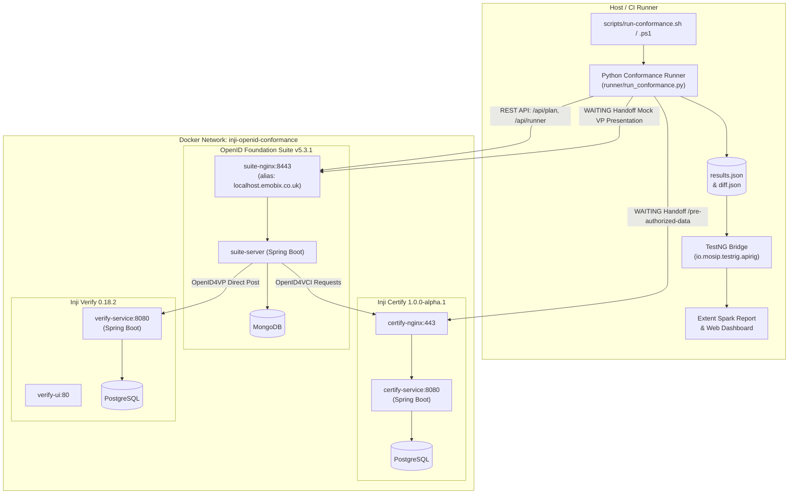
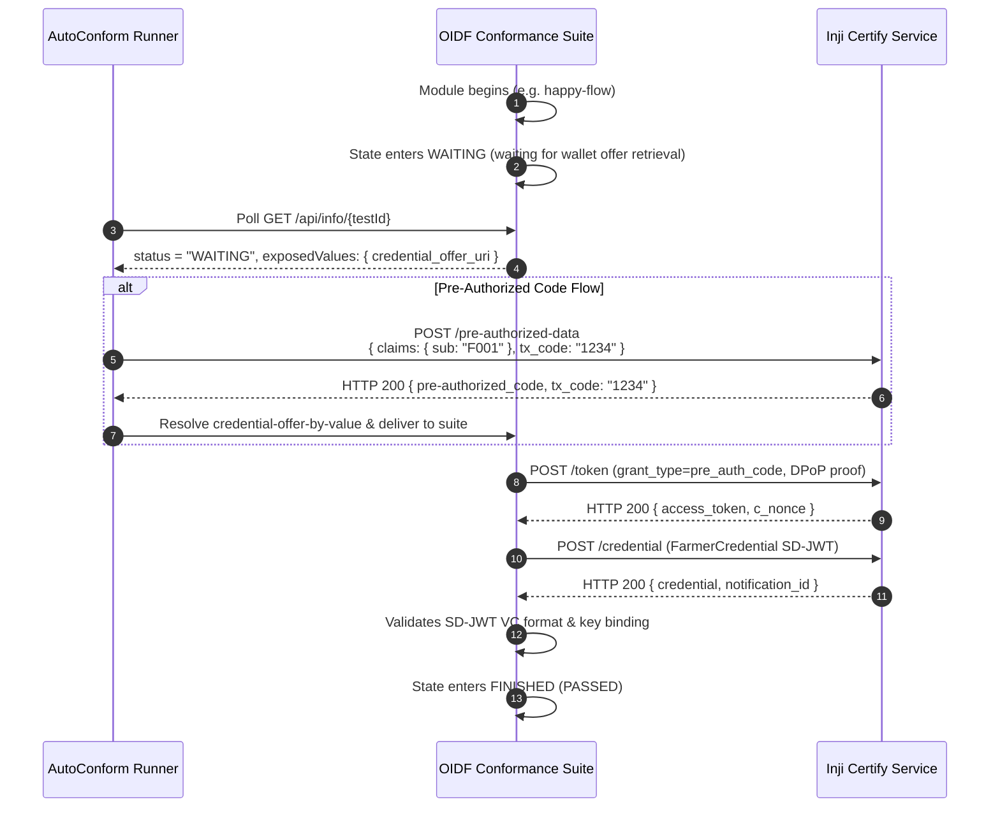
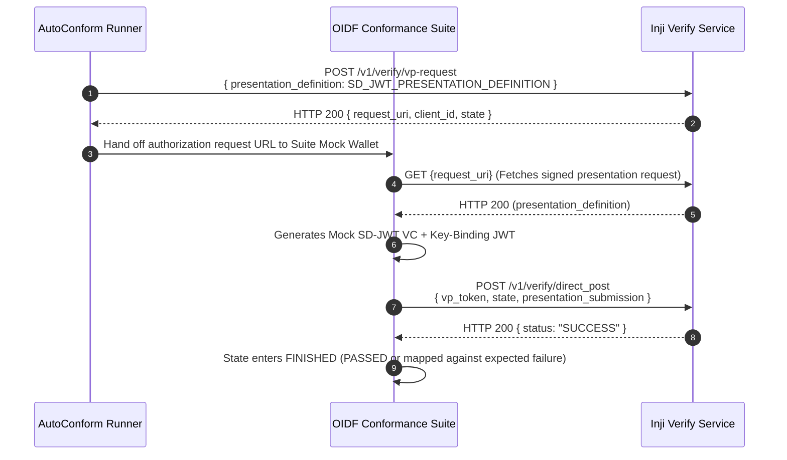
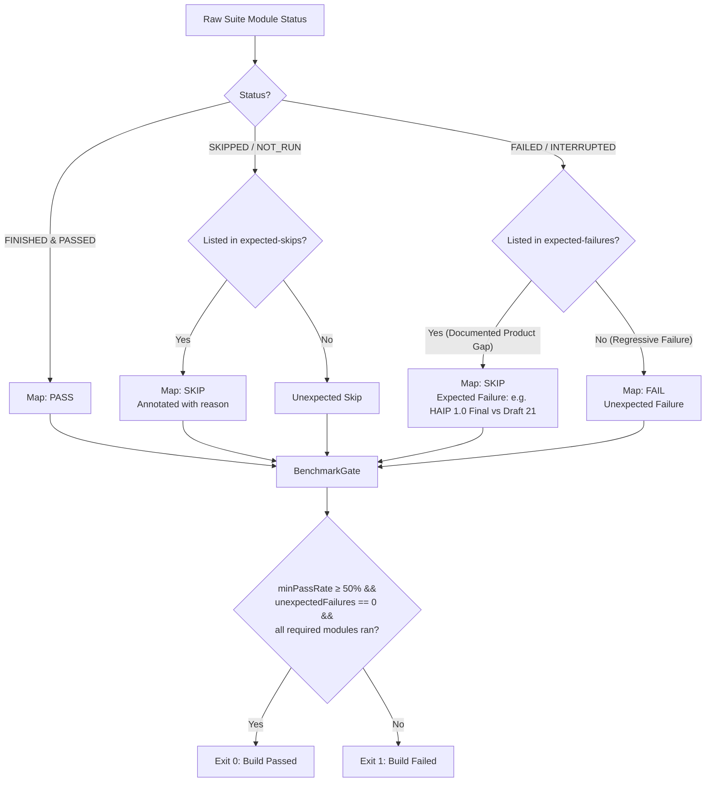

# AutoConform Architecture Specification

AutoConform provides a unified, automated, CI-ready conformance harness for **MOSIP Inji Certify** (credential issuer) and **MOSIP Inji Verify** (verifier).

The core design principle is **strict separation of concerns**:
- **Protocol Truth**: OpenID protocol logic, cryptographic evaluations, and conformance assertions stay exclusively in the official **OpenID Foundation (OIDF) Conformance Suite**.
- **Orchestration**: The Python runner (`runner/run_conformance.py`) handles test lifecycle, configuration rendering, dynamic WAITING-handoff automation, and polling.
- **Reporting & Governance**: Conformance results map directly into MOSIP's native `io.mosip.testrig.apirig` TestNG framework and Extent Spark reporting.

---

## 1. End-to-End System Architecture

---

## 2. Automated WAITING-Handoff Mechanism

Interactive OpenID4VCI and OpenID4VP test modules pause in a `WAITING` state, expecting a physical mobile wallet user to scan a QR code and present credentials. AutoConform automates this completely without human intervention.

### A. Inji Certify (Issuer) Pre-Authorized Code Handoff

### B. Inji Verify (Verifier) Mock Presentation Handoff

---

## 3. Results Governance & Benchmark Gate

Test outcomes are classified and mapped into TestNG results via `ResultMapper.java` and `BenchmarkGate.java`:

---

## 4. CI/CD GitHub Actions Pipeline

```mermaid
flowchart LR
    Push[git push / PR] --> Setup[Setup Python & Java]
    Setup --> DockerBoot["docker compose up -d<br/>(OIDF + Certify + Verify)"]
    DockerBoot --> Health["Wait for /ready &amp; /healthcheck"]
    Health --> RunHarness["python runner/run_conformance.py --combined"]
    RunHarness --> GenResults["results/results.json &amp; diff.json"]
    GenResults --> TestNGBridge["mvn test -Dconformance.reuseResults=true"]
    TestNGBridge --> ExtentReport["Generate Extent Spark HTML"]
    ExtentReport --> Upload["Upload Artifacts &amp; Publish Dashboard"]
```

---

## 5. Network & Security Architecture

1. **Shared Network (`inji-openid-conformance`)**:
   All 7 containers operate on an isolated bridge network with service discovery.
2. **Suite Host Alias (`localhost.emobix.co.uk`)**:
   The suite issues self-signed TLS certificates for `localhost.emobix.co.uk`. Inji Certify and Verify resolve this alias directly over Docker's internal DNS to satisfy OpenID `redirect_uri` and callback host matching.
3. **Transport Security & DPoP Binding**:
   - Inji Certify is reverse-proxied through NGINX with SSL termination on port 443.
   - RFC 9449 Demonstrating Proof-of-Possession (DPoP) is enforced on all token and credential requests.
4. **Endpoint Aliases**:
   - Certify Issuer: `https://certify-nginx`
   - Verify Service: `http://verify-service:8080/v1/verify`
   - Suite NGINX: `https://localhost.emobix.co.uk:8443`
